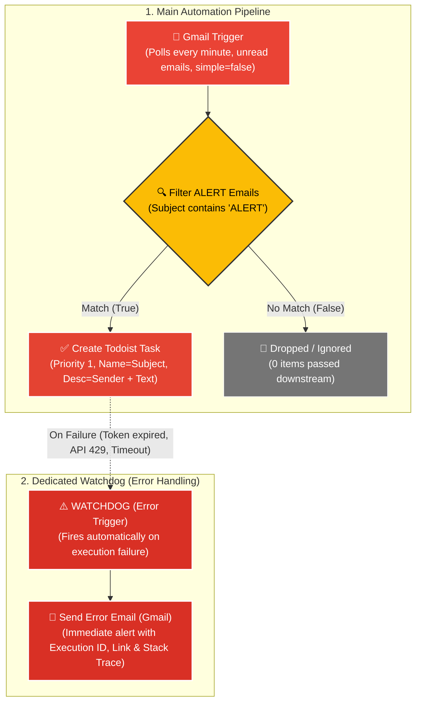
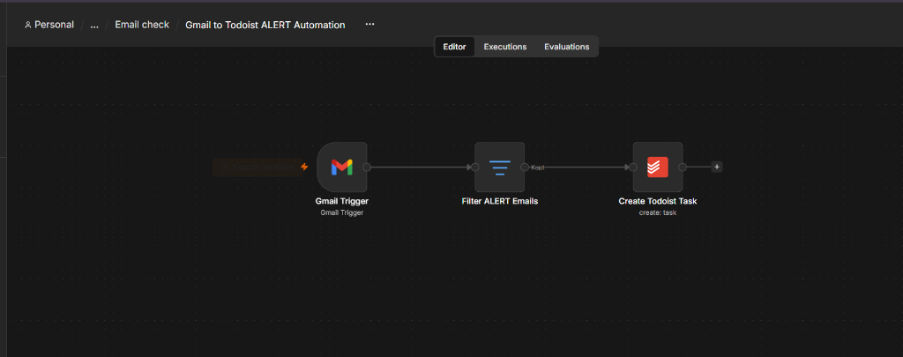
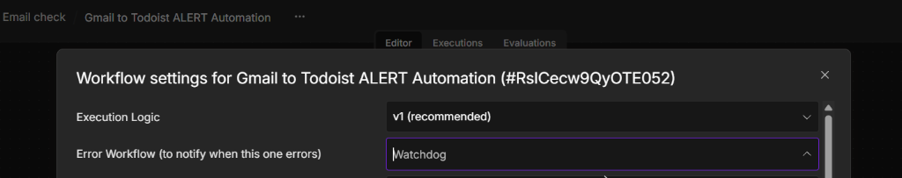
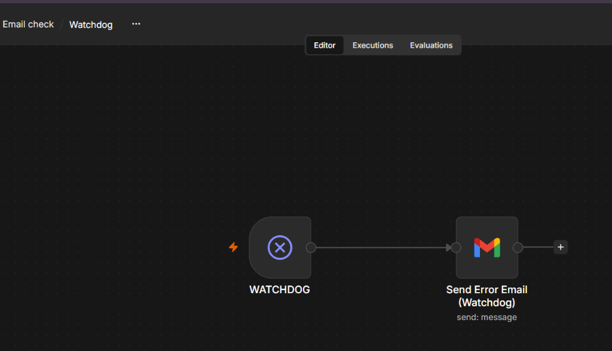
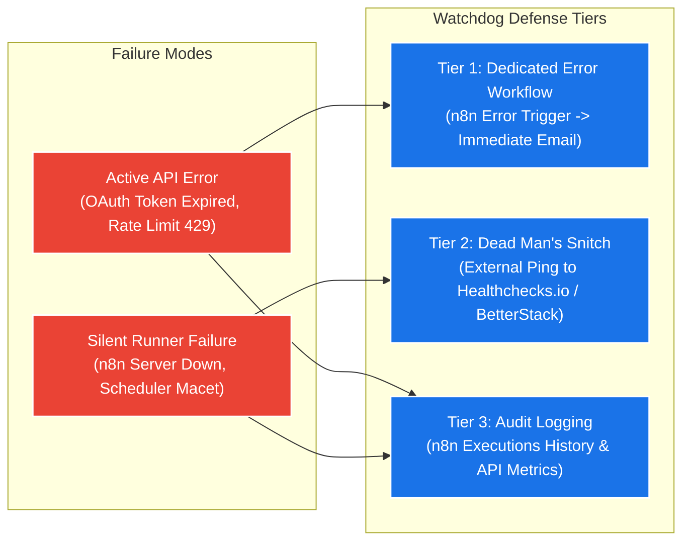

# Gmail to Todoist ALERT Automation with Dedicated Watchdog

An enterprise-grade, event-driven automation built on **n8n** that monitors incoming Gmail emails, filters for high-priority alerts, creates actionable tasks in **Todoist**, and features a dedicated **Watchdog Error Handler** for continuous reliability.

---

## 📌 Architectural Overview



---

## 💡 Platform Choice: Why n8n?

While popular cloud platforms like **Make.com** and **Zapier** are excellent automation tools, **n8n** was chosen for this implementation because:
1. **Existing Environment & Efficiency**: The author operates an active n8n instance, allowing for faster, friction-free deployment and native workflow management.
2. **No Compromise on Quality or Functionality**: n8n delivers full feature parity with Zapier and Make, offering superior node-level control, flexible JavaScript expression syntax, and native support for dedicated error workflows.
3. **Data Privacy & Control**: Credentials and email contents remain securely processed within the self-hosted environment without third-party vendor lock-in.

---

## 📸 Workflow Implementation Screenshots

### 1. Main Pipeline Canvas
The main automation connects the `Gmail Trigger`, passes through the `Filter ALERT Emails` node, and lands on `Create Todoist Task`.



### 2. Workflow Settings & Error Workflow Link
In the workflow settings, the `Error Workflow` is explicitly configured to invoke the dedicated **Watchdog** workflow whenever a failure occurs.



### 3. Dedicated Watchdog Workflow Canvas
The standalone Watchdog workflow catches unhandled errors via an `Error Trigger` node and dispatches an immediate email alert containing error details and direct debugging links.



---

## 📋 Comprehensive System Design

### a) Description of Trigger, Filter, and Action

#### 1. The Trigger: `Gmail Trigger`
* **Polling Cadence**: Configured to poll every minute (`everyMinute`).
* **Ingestion Filter**: `filters.readStatus = 'unread'`. This ensures only newly arrived, unprocessed emails are captured, preventing infinite re-triggering loops.
* **Payload Retrieval (`simple: false`)**: 
  * By default, n8n sets `simple: true`, which only fetches minimal header metadata and a brief text snippet.
  * We explicitly set `simple: false` to retrieve the complete MIME body, exposing `$json.text` (full plain text email content) and structured sender data (`$json.from`).

#### 2. The Filter: `Filter ALERT Emails`
* **Condition Evaluated**:
  * **Target Expression**: `{{ $json.subject }}`
  * **Operator**: `contains`
  * **Target String**: `ALERT`
* **Behavior**:
  * If the incoming email subject contains the string `"ALERT"`, the item is emitted to the main output (index 0) and proceeds to Todoist.
  * If the subject does **not** contain `"ALERT"`, the node outputs `0 items` to the downstream path. The execution terminates cleanly with no tasks created (*All other emails are ignored*).

#### 3. The Action: `Create Todoist Task`
* **Resource**: `task`
* **Operation**: `create`
* **Field Mapping**:
  * **Task Name (`content`)**: `={{ $json.subject }}` (The exact email subject becomes the task title).
  * **Task Priority (`options.priority`)**: `1` (Configured to priority 1 as requested).
  * **Task Description (`options.description`)**:
    ```text
    =Sender: {{ $json.from.text || $json.from.value[0].address || $json.from }}

    Message:
    {{ $json.text }}
    ```
    *Note: Safe expression fallbacks ensure the sender address is cleanly parsed whether Gmail returns a structured object or a raw string.*

---

### b) Testing Methodology

Testing is divided into **Mock Execution Testing (Pin Data)** and **Live End-to-End Testing**.

#### 1. Unit Mock Testing in n8n (Verified & Validated)
Using n8n's native data pinning engine, the workflow was verified against simulated test payloads:

* **Positive Test Run (Execution ID `#1313310`)**:
  * **Input Payload**:
    * Subject: `"ALERT: Database high load"`
    * Sender: `devops@example.com`
    * Body: `"Database CPU reached 98%"`
  * **Result**: Passed filter evaluation; `Create Todoist Task` successfully executed with Priority 1, matching title, and formatted description. Status: **Success**.

* **Negative Test Run (Execution ID `#1313358`)**:
  * **Input Payload**:
    * Subject: `"Meeting Agenda for Tomorrow"` (no ALERT keyword)
    * Sender: `colleague@example.com`
    * Body: `"Hi team, here is the agenda for tomorrow morning."`
  * **Result**: Filter discarded the message (`main: []`). Downstream Todoist node was **skipped completely**.

#### 2. Live End-to-End Verification Instructions
To test the live workflow with a real email, send an email to the connected Gmail inbox using the samples below:

##### ✅ Sample Alert Email (Expected: Task Created)
* **To**: *(Your connected Gmail address)*
* **Subject**: `ALERT: Production Database High CPU Load [CRITICAL]`
* **Body**:
  ```text
  Hello Team,

  This is an automated alert from the Infrastructure Monitoring Service.

  Incident Details:
  - Server: prod-db-replica-02
  - Metric: CPU Utilization exceeded 98% for 5 consecutive minutes.
  - Action Required: Please inspect active query locks and connection pools immediately.

  Best regards,
  DevOps Alert System
  ```

##### ❌ Sample Normal Email (Expected: Ignored)
* **To**: *(Your connected Gmail address)*
* **Subject**: `Weekly Team Sync Notes - Review Required`
* **Body**:
  ```text
  Hi team,

  Attached are the summary notes from today's weekly sync meeting.
  Please review when you have a moment.
  ```

A helper Python test script is also provided in `scripts/send_test_email.py`:
```bash
python scripts/send_test_email.py \
  --sender your-email@gmail.com \
  --password your-app-password \
  --recipient target-email@gmail.com \
  --type alert
```

---

### c) Watchdog & Reliability Architecture

A **"Watchdog"** is a dedicated monitoring mechanism designed to detect when an automated process fails, stalls, or encounters runtime errors. In this system, reliability is maintained across three distinct tiers:



#### Tier 1: Dedicated Error Workflow (`Watchdog`)
* **Trigger**: `Error Trigger` node (`n8n-nodes-base.errorTrigger`).
* **Connection**: Linked in the main workflow settings under `settings.errorWorkflow = "Watchdog"`.
* **Execution**: Whenever an active run fails (e.g., Todoist API returns 401 Unauthorized, rate limit 429, or network drop), n8n halts the main run and instantly executes the Watchdog workflow.
* **Notification Payload**: An automated HTML email is sent via Gmail to the admin containing:
  * Workflow Name and Workflow ID
  * Failed Execution ID
  * Direct Link to the error log in n8n for one-click inspection
  * Complete error message and technical stack trace.

#### Tier 2: Passive "Dead Man's Snitch" (For Silent / Infrastructure Outages)
* **The Problem**: If the n8n host server crashes, docker stops, or the internal cron daemon locks up, the Error Trigger cannot fire because n8n itself is offline.
* **The Solution**: An external heartbeat monitor (such as [Healthchecks.io](https://healthchecks.io) or [BetterStack](https://betterstack.com)).
* **Implementation**: At the end of every scheduled polling interval, an HTTP GET request pings a designated external healthcheck endpoint. If the external service does not receive a ping within a grace period (e.g. 15 minutes), it broadcasts an emergency alert to Slack, SMS, or Telegram warning that the n8n automation engine has stalled.

#### Tier 3: Execution Log Auditing
* Built-in n8n **Executions** tab tracks all runtime instances, execution durations, and retry counts.
* The n8n API endpoint (`/api/v1/executions?status=error`) or Prometheus metrics (`/metrics`) can be scraped by Grafana for centralized observability.

---

## 📁 Repository Structure

```text
├── README.md                                         # Comprehensive documentation & system guide
├── screenshots/
│   ├── 01_main_workflow_canvas.png                   # Canvas view of Gmail -> Filter -> Todoist
│   ├── 02_workflow_settings_watchdog.png             # Settings linking to Watchdog workflow
│   └── 03_watchdog_workflow_canvas.png               # Canvas view of Watchdog Error Trigger -> Email
├── workflows/
│   ├── gmail_to_todoist_alert_automation.json        # Main workflow export (JSON)
│   └── watchdog_error_workflow.json                  # Watchdog error workflow export (JSON)
└── scripts/
    └── send_test_email.py                            # CLI tool to send alert and normal test emails
```

---

## 🚀 Setup & Deployment Instructions

1. **Import Workflows**:
   * Open your n8n workspace.
   * Import `workflows/gmail_to_todoist_alert_automation.json` and `workflows/watchdog_error_workflow.json`.
2. **Connect Credentials**:
   * On **Gmail Trigger** and **Send Error Email**: Select your connected Gmail OAuth2 account.
   * On **Create Todoist Task**: Select your connected Todoist API token.
3. **Verify Settings**:
   * Ensure `Error Workflow` in the main workflow settings points to the `Watchdog` workflow.
4. **Activate**:
   * Toggle the **Active** switch on both workflows to begin real-time 24/7 monitoring.
